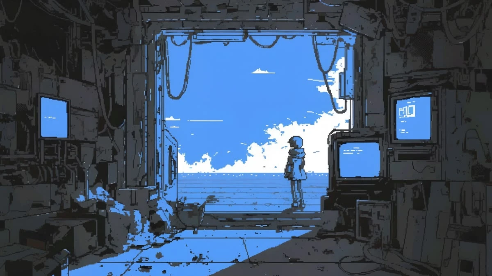

# JSGame

Обучающая браузерная игра, в которой JavaScript учат, когда пишут настоящий код: он оживляет тихий пиксельный мир.

**Стадия:** концепция.

- Бриф проекта и правила: [CLAUDE.md](CLAUDE.md)
- Визуальный референс: [docs/reference/mood.webp](docs/reference/mood.webp)
- Механика: `docs/MECHANICS.md` (в работе)

